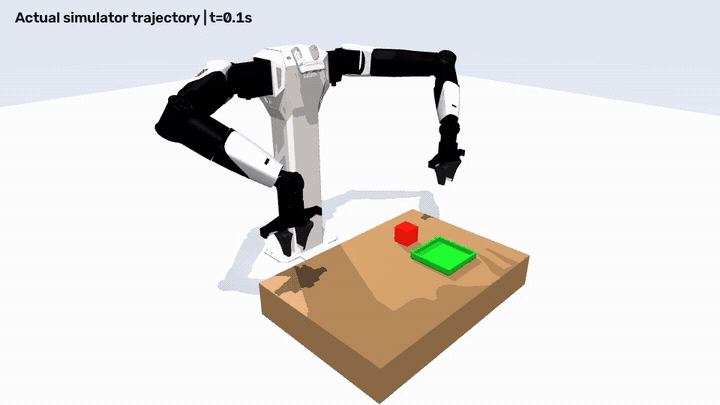

# AgileX dual-NERO · Workshop on Agentic Robotics

Robot platform for the [Workshop on Agentic Robotics](https://agentic-robotics-workshop.github.io/)
at CoRL 2026. This repository provides the participant code and robot APIs for
our live demo platform.

Deploy **code-as-policy** and **agent-as-policy** on a fixed dual-NERO robot:
two seven-axis arms, independently controlled grippers, and one stand-mounted
ZED 2i RGB-D camera. There are no wrist cameras.

Simulation and hardware expose the same Python and MCP interfaces for camera
capture, pixel deprojection, official AgileX IK/FK, joint/TCP motion, grippers,
and operation feedback. Select `--backend sim` or `--backend real`; participant
policy code and tool names stay the same.

**Physical status:** the organizer has confirmed both policy formats working on
the installed robot (October 20, 2026). The results below are separately scored
**simulator** runs, not physical benchmark scores.

[Participant guide and API](docs/WORKSHOP.md) ·
[Python SDK](src/agilex_deploy/workshop_client.py) ·
[MCP tools](src/agilex_deploy/workshop_mcp.py) ·
[IK and motion planning](docs/MOTION_PLANNING.md)

## Simulator results

Both demonstrations use live OpenRouter model `google/gemini-3.8-flash`, the
head RGB-D camera, measured robot feedback, and simulated finger/object contacts.
Policies receive no simulator object coordinates or scoring state. Each run
picks up the red cube with the left arm, places it in the green tray, releases
it, and retracts. These are model-driven runs, not the scripted RGB-D baseline.

### Code-as-policy: generated Python

The model writes Python, the host executes it through `RobotClient`, and the
model inspects execution results and fresh images before finishing.


[Full-resolution video](previews/workshop_code_policy.mp4) ·
[Runner and SDK prompt](examples/workshop/generated_code_policy.py)

### Agent-as-policy: MCP tool calls

The model calls MCP tools for perception, motion, independent gripper control,
and measured operation completion.



[Full-resolution video](previews/workshop_mcp_policy.mp4) ·
[Runner and tool prompt](examples/workshop/agent_policy.py)

| Independent simulator evaluation | Generated Python | MCP agent |
| --- | ---: | ---: |
| Placement success | Pass | Pass |
| Maximum cube lift | 125.9 mm | 126.1 mm |
| Stable tray support at scoring | 3.46 s | 13.69 s |
| Scored robot/environment collision frames | 0 | 0 |

GIFs preserve the entire recorded trajectory at **1× simulation-time playback**,
including stationary periods while the model responds. The external view is
for observers; the policy sees the head camera. These are two successful trials,
not a success-rate estimate. [Metrics and video provenance](previews/workshop_policy_results.json).

## Participant quick start

On the prepared [workshop](https://agentic-robotics-workshop.github.io/) desktop, use its existing `.venv-official` environment.
For a fresh **Linux x86_64** checkout:

```bash
git clone https://github.com/ZiWang1105/agile-x-deploy.git agilex-deploy
cd agilex-deploy
./scripts/setup_official_ik.sh
./scripts/setup_gripper.sh
.venv-official/bin/python -m pip install -r requirements-agent.txt -r requirements-workshop.txt
```

These setup commands install dependencies and build models; they do not enable
the robot. Generated Python execution requires Linux Landlock ABI ≥3 and
libseccomp; see [execution isolation](docs/WORKSHOP.md#execute-model-generated-python).

Create `openrouter_key.txt` **inside the repository**, containing only your
OpenRouter API key, then run `chmod 600 openrouter_key.txt`. This file is ignored
by Git; never include it in a participant handoff or commit. `--key-file PATH`
overrides the default location.

Run **one** of these commands from the repository root:

```bash
# Code-as-policy: the model generates executable Python using the SDK.
.venv-official/bin/python examples/workshop/generated_code_policy.py --backend sim \
  --prompt 'Put the red cube in the green tray using the left arm, release it, and retract.'
```

```bash
# Agent-as-policy: the model calls MCP tools.
.venv-official/bin/python examples/workshop/agent_policy.py --backend sim \
  --prompt 'Put the red cube in the green tray using the left arm, release it, and retract.'
```

Each command starts the service and opens the dashboard. Review the camera and
prompt, then click **Enable & start policy**. No separate service or browser
command is needed. The page shows live camera/robot feedback, generated Python
or MCP calls, execution output, and model-wait timing.

Both runners default to **100 model calls per prompt**. Use `--model` and
`--max-calls` to override. After a round, submit another prompt in the same
website; each round gets a fresh budget and fresh observations. Follow-up rounds
do not reset the robot or grippers. **STOP** ends motion and latches the session;
a new prompt cannot clear it. **Close session** or Ctrl-C exits.

The dashboard defaults to port **8780**. Close a previous session first, or use
`--port 0` for an available port. `--task place|select|sort` chooses the simulator
layout; `--prompt` supplies the policy's instruction.

| Simulator task | Objective |
| --- | --- |
| `place` | Put the red cube in the green tray. |
| `select` | Put the blue cube in the green tray without moving the red cube. |
| `sort` | Use both arms to place the colored cubes in their corresponding trays. |

## Write your own policy

The [Python API guide](docs/WORKSHOP.md#python-code-as-policy) documents
`observe`, `capture`, `deproject`, `ik`, `fk`, `move_tcp`, `move_joints`,
`move_both`, `follow_waypoints`, `gripper_open`, `gripper_close`, and `hold`.
Motion and gripper commands return operations; wait for a measured terminal
result before the next command. Left and right grippers are independent.

Generated Python defines `run(robot)`; the host provides an already claimed
client. The agent's [SDK instructions](examples/workshop/generated_code_policy.py)
and [MCP instructions](examples/workshop/agent_policy.py) are in the examples.
For your own agent framework, use the [MCP connection guide](docs/WORKSHOP.md#mcp-agent-as-policy)
and the same [tool definitions](src/agilex_deploy/workshop_mcp.py).

With an organizer-managed service, use `--config PATH` to attach either runner
instead of launching another service. Do not combine `--config` and `--backend`.
The guide also includes a [scripted Python example](examples/workshop/code_policy.py)
for learning the API without a model request.

## Run on the physical robot

Use the same command with **`--backend real`** and a prompt describing the actual
objects. The physical robot is not reset by `--task`. The organizer prepares the
objects, verifies the camera/arm mapping, and enables the session.

```bash
.venv-official/bin/python examples/workshop/generated_code_policy.py --backend real \
  --prompt 'Pick up the orange using the left arm, lift it 10 cm, and hold for 10 seconds.'
```

Replace `generated_code_policy.py` with `agent_policy.py` for MCP. Close other
robot controllers and camera owners first. Both arms must start disabled;
after USB reconnect or reboot, [activate CAN and verify feedback](#activate-can-before-real-robot-use).
The same dashboard waits for **Enable & start policy** before enabling motors.

Gravity compensation and automatic hand-guiding are **off by default**.
Enable starts position HOLD. Policy completion, STOP, Close, and Ctrl-C retain
holding torque; they do not disable the arms. To remove torque, close the
controller, mechanically support **both arms**, then run:

```bash
.venv-official/bin/python -m agilex_deploy.hardware_power --arms-supported
```

To also open both jaws, add `--open-grippers`. That option temporarily enables
one supported arm at a time in current-pose HOLD to open its gripper, then
re-disables the arm. The gripper actuator remains enabled to hold its open target.
Support any held object before releasing it.

The shared controller uses official AgileX IK, sampled Cartesian paths, and
controller joint limits. It does **not** plan obstacle avoidance. The simulator's
contact model and measured hardware calibration differ; physical task setup and
results remain the organizer's responsibility. Experimental physical
`--gravity-comp` is blocked; [hand-guiding diagnostics](docs/HAND_GUIDING.md)
are separate from the [workshop](https://agentic-robotics-workshop.github.io/) workflow.

[Physical deployment details](docs/WORKSHOP.md#real-deployment) ·
[Camera calibration](docs/CAMERA_CALIBRATION.md) ·
[Official IK provenance and parameters](docs/OFFICIAL_IK.md)

## Hardware utilities and development

The remaining sections cover camera setup, interactive IK, CAN configuration,
and source-model provenance. Participants can use the [workshop](https://agentic-robotics-workshop.github.io/) launchers above
without running the separate camera-stream or interactive-IK services.

## ZED 2i live camera stream

Connect the camera over USB 3, then run:

```bash
cd ~/projects/agilex-deploy
./scripts/setup_zed_stream.sh  # Once per checkout; installs into .venv-camera.
./scripts/zed_stream.sh start
```

Open **http://127.0.0.1:8766** on the connected desktop. The page switches between
left, right, and side-by-side stereo views. Capture is 2560 × 720 at 30 fps,
giving 1280 × 720 per eye. This is raw UVC color; it does not require the ZED SDK
and does not provide depth or calibrated/rectified imagery.

```bash
./scripts/zed_stream.sh status
./scripts/zed_stream.sh logs
./scripts/zed_stream.sh stop
./scripts/zed_stream.sh restart
```

`start` creates an observable `agilex-zed-stream` systemd user service that stays
running after the terminal closes. It is not installed for automatic startup at
boot. Starting an already active service preserves it; use `restart` to apply
code or option changes. For a foreground process, stop the service and run
`./scripts/zed_stream.sh run`; Ctrl+C releases the camera.

The stream automatically selects the only ZED capture device in `/dev/v4l/by-id`.
If multiple cameras are present, select one explicitly:

```bash
./scripts/zed_stream.sh restart --device /dev/v4l/by-id/YOUR_ZED-video-index0 --port 8766
```

Endpoints on the same local server:

| Endpoint | Result |
|---|---|
| `/` | Browser viewer |
| `/stream.mjpg?view=left` | Live multipart JPEG stream |
| `/snapshot.jpg?view=left` | Latest fresh JPEG frame |
| `/status` | Capture health, frame age, sequence, measured fps, resolution, and device |

Use `view=right` or `view=stereo` for the other images. No frames are recorded to
disk. The server binds to loopback only. For remote viewing, forward the port
with `ssh -N -L 8766:127.0.0.1:8766 USER@ROBOT_DESKTOP`, then open the same URL
on the SSH client. Stop this stream before opening the camera in another program.
If capture fails or frames become stale, image endpoints refuse stale snapshots;
inspect `/status` and the logs, check the USB connection, then restart.

Dependencies are pinned separately in `requirements-camera.txt`. The scripts
use neither the IK environment nor robot control interfaces. This standalone UVC stream is separate from the [workshop](https://agentic-robotics-workshop.github.io/) RGB-D capture API;
close it before a [workshop](https://agentic-robotics-workshop.github.io/) session opens the same camera. The connected ZED 2i was
verified at approximately 30 fps with all three image views and consecutive
decodable MJPEG frames.

## Calibrate the head camera

The ZED calibration workflow plans a nine- or fifteen-pose single-arm route with official IK,
records stationary images with measured joints, lets you select fixed 3D arm
landmarks and their image pixels, then fits a candidate camera transform with
held-out-pose validation. See [the calibration guide](docs/CAMERA_CALIBRATION.md).

```bash
./scripts/setup_camera_calibration.sh
.venv-official/bin/python scripts/calibrate_camera.py demo --output logs/calibration/demo
.venv-official/bin/python scripts/calibrate_camera.py annotate --dataset logs/calibration/demo/dataset.json
```

This opens an explicitly synthetic rehearsal dataset at http://127.0.0.1:8772.
Real captures need this ZED's matching raw intrinsics. Physical route execution is
separate and explicit; fitting never applies calibration or commands the arms.

The [physical calibration archive](calibration/2026-10-15_zed35330610/README.md)
includes raw images, measured joints, assistant-selected landmarks and calculated
extrinsics for ZED serial `35330610`. The latest raised sequence has 15 captures
and 132 observations: 4.521 px all-point RMS and 7.010 px worst held-out-pose RMS.
The [workshop](https://agentic-robotics-workshop.github.io/) loads `raised_probe/results_agent_v2/candidate.json` by default.
Its camera transform is used by pixel deprojection; verify the calibration when
the mount or physical setup changes.
The archive includes earlier results, annotation corrections and reproduction
instructions. The [camera mount design](hardware/zed2i_mount/README.txt) includes
printable STL, editable STEP and installation illustrations.

## Run interactive IK

Run in a desktop terminal:

```bash
cd ~/projects/agilex-deploy
./scripts/setup_official_ik.sh  # First checkout: isolated Pinocchio/CasADi environment.
./scripts/run_interactive.sh --backend sim
```

Clone with `git clone https://github.com/ZiWang1105/agile-x-deploy.git agilex-deploy` to use the directory name above. The repository includes the source assets required by this assembly; the original upload archives are not needed to build it. The setup uses `.venv-official` because standard pip Pinocchio wheels do not provide the required CasADi binding. The old `.venv` is preserved; missing official dependencies cause an explicit error, never a fallback solver. Generated files in `build/` are ignored. `build/dual_nero.sim.xml` is generated automatically from the geometry model when absent.

- Double-click a red sphere to select a TCP target.
- Hold **Ctrl + right mouse button** and drag to translate the target.
- Hold **Ctrl + left mouse button** and drag to rotate the target. Shift changes the manipulation plane/axis using MuJoCo's native controls.
- **1 / 2** toggle the left/right gripper target.
- **Space / R** enter HOLD and reset handles to the measured TCPs. Drag again to resume.
- **Q** or window close exits and releases the owned control thread.

Red spheres/axes are targets; small green markers are encoder-derived TCPs. The display reports position/orientation error and runtime state. The renderer has its own model; dragging robot geometry or using native Reset cannot reset or force the simulated plant. Native Reset requests HOLD.

The CLI uses the active desktop's `DISPLAY`. On this machine, `DISPLAY=:1 ./scripts/run_interactive.sh` was tested successfully. Prefer the display variable supplied by your desktop session. The command stays in the foreground; no server or detached process is installed.

## Activate CAN before real robot use

After rebooting or reconnecting the robot's USB cable, check the interfaces with
`ip -details link show type can`. If they are DOWN, activate both at **1 Mbps**,
the default bitrate in AgileX's installed `pyAgxArm` SDK. Close any running robot
controller before reconfiguring CAN; the commands below briefly bring each
interface down.

```bash
sudo ip link set can0 down
sudo ip link set can0 type can bitrate 1000000 listen-only off
sudo ip link set can0 up

sudo ip link set can1 down
sudo ip link set can1 type can bitrate 1000000 listen-only off
sudo ip link set can1 up
```

These commands activate communication only; they do not enable motors or send
arm/gripper motion commands. Normal CAN mode (`listen-only off`) permits bus
acknowledgements and later controller commands.

Verify both interfaces and then request receive-only joint feedback:

```bash
ip -details -statistics link show type can
cd ~/projects/agilex-deploy
.venv-official/bin/python -m agilex_deploy.can_feedback --output logs/commissioning/live_snapshot.json
```

Both interfaces should show `UP`, `bitrate 1000000`, and `can state ERROR-ACTIVE`.
`ERROR-ACTIVE` is the normal CAN operating state, not an error report. The
feedback command must also succeed: an UP interface alone does not establish
that a powered arm is responding. If feedback times out, check robot power and
USB/CAN cabling before starting a policy.

The current mapping is robot-left `can1`, robot-right `can0`. Linux can renumber
interfaces after reconnection; the application resolves arms by confirmed USB
serials in `configs/hardware_mapping.json`. If the interfaces have different
names, substitute the names shown by `ip` above. Activation does not persist
across every reboot or USB reconnection.

## Live hardware mirror and IK preview

On the commissioned desktop, with both CAN interfaces already configured at 1 Mbps:

```bash
DISPLAY=:1 ./scripts/run_interactive.sh --backend real-preview
```

Blue arms show physical joint feedback. Translucent amber arms show simulated IK, initialized from the physical joint angles when the application starts. Drag the red EEF targets with the same controls as simulation. **Targets command only the preview simulator; this mode cannot enable or move hardware.** Press **M** to hide/show the amber preview and inspect the blue measured posture. Space/R stops only the simulation preview. Gripper controls are disabled and fingers are hidden because physical travel is not calibrated.

The reader resolves each arm by the confirmed USB serial in `configs/hardware_mapping.json`, even if Linux renumbers `can0`/`can1`. It refuses missing/ambiguous adapters, stale feedback, receive overflow, and excessive paired-frame skew. A hardware feedback fault freezes the last measured display, cancels preview tracking, and requires restart. This is a receive-only commissioning tool, not the `RealBackend` motion transport. It does not fabricate physical velocity or gripper measurements to satisfy the full robot contract.

```bash
# Read a paired joint snapshot; sends no CAN data frames.
.venv-official/bin/python -m agilex_deploy.can_feedback --output logs/commissioning/live_snapshot.json

# Test simulated IK from live joints and render a comparison image/report.
MUJOCO_GL=egl .venv-official/bin/python scripts/validate_live_preview.py
```

See [hardware commissioning](docs/HARDWARE_COMMISSIONING.md) for the remaining steps before physical following.

## Single-arm physical commissioning

For full-workspace mouse control, start with both arms supported and disabled, clear the arm's movement area, then run:

```bash
DISPLAY=:1 ./scripts/run_interactive.sh --backend real-commissioning --side both --workspace full --gripper
```

This starts **UNARMED**. E enables the selected arms in position HOLD by default; submitting a target starts follower control from fresh measured joints. Double-click either red sphere, Ctrl+right-drag to translate, and Ctrl+left-drag to rotate. Full mode removes the radius, height floor, orientation cap and joint excursion cap relative to the arming pose. Full workspace is now the default. Joint position limits, live controller speed/acceleration limits, pair-wide ownership and communication watchdogs remain. The old 0.03 rad/s, 0.1 rad/s², 5% firmware speed and arbitrary tracking-error caps are removed. It is not a collision-aware planner: the table, stand, opposite arm and other obstacles are not protected. An IK target may be unreachable even though the handle can be dragged there. Space requests position HOLD during tracking; Q normally holds position and closes the controller with motors enabled. Automatic hand-guiding is disabled unless `--gravity-comp` is supplied. Fault cleanup does not force a mode transition. See [optional hand-guiding](docs/HAND_GUIDING.md). To use the identical full-workspace controls without hardware access, replace `real-commissioning` with `commissioning-sim`.

On **E**, the transport selects CAN joint-position mode at **100% of the controller's configured speed**, reads that selected controller's seven position/speed/acceleration limits while disabled, seeds current angles, then enables its joints. Incomplete readback prevents enable; settings from the other arm are never substituted. The speed reference respects the lower of the manual maximum and controller readback. Joint position bounds use the intersection of the supplied URDF and controller settings, without additional margins.

The October 14 left-arm readback was `[3.14, 3.14, 3.14, 3.14, 3.92, 3.92, 3.92]` rad/s and `[2, 2, 2.5, 2.5, 2.5, 2.5, 2.5]` rad/s². These are ceilings, not constant commanded speeds. Simulation uses that readback as an explicit offline fixture for both arms; real sessions read their own selected controller anew. The right-arm read-only probe did not return limits in its observed mode.

Torque/current protection remains in the firmware, unchanged by this host. A numeric hardware torque ceiling has not been verified: URDF effort `100` and MIT torque encoding `±16 Nm` are not evidence of a safe joint torque limit. The simulator's force range is not a validated hardware torque model. See [limit provenance](docs/HARDWARE_COMMISSIONING.md#motion-limit-sources).

**G** requests a fixed nominal-TCP target 30 mm above the arming pose; repeated presses do not accumulate movement. Grippers are not enabled or commanded by default. Add `--gripper` to expose selected-side feedback and explicit open/close keys; **E** and pose dragging alone still send no gripper commands. See [gripper control](docs/GRIPPER_CONTROL.md). An optional legacy envelope remains available only with explicit `--workspace bounded`; it is never selected by default.

To open both physical jaws and finish with both arms disabled, close active
controllers, mechanically support both arms, and run:

```bash
.venv-official/bin/python -m agilex_deploy.hardware_power --arms-supported --open-grippers
```

This temporarily holds each arm at its measured joint positions while opening
its jaw, verifies opening from feedback, then disables the arm again.
Omit `--open-grippers` for disable-only behavior.

Gripper motion uses AgileX's official width/force command path. The shared `Observation.gripper_states` reports measured endpoint progress, stationary shortfall, and available width/force/status feedback; the viewer displays those states. A `stalled` report is not a confirmed grasp and does not alter the firmware target. This is feedback supervision, not a port of Hexfellow's host-side motor-effort regulator. The simulator reports force as unavailable, and physical force behavior remains untested.

**Space/R** requests servo HOLD. **Q/window close requests HOLD and leaves motors enabled**; it does not release the arm or guarantee physical emergency stopping. A CAN or power failure can prevent HOLD. Full-range physical following and failure-stop behavior remain unqualified. Use `--side both` (the default) to control both arms and both grippers in one owned session; `--side left` and `--side right` retain single-arm selection. Both buses share admission, watchdog, and fault handling. A fault on either side requests HOLD on both.

Practice the identical arming/UI workflow without opening CAN:

```bash
DISPLAY=:1 ./scripts/run_interactive.sh --backend commissioning-sim --side both --gripper
.venv-official/bin/python scripts/check_real_session.py  # Reads real feedback; never arms.
```

The hardware control loop runs in an owned, joined child process. A viewer heartbeat gap over 200 ms latches HOLD independently of the viewer's Python GIL. This covers viewer failure; it is not a certified controller-level watchdog or proof of stopping after the control process, host, CAN link, or power fails.

## Same interface for sim, real, and agents

```python
observation = robot.observe()
request_id = robot.submit_target(action, observation.observation_id)
robot.hold()
robot.close()
```

`Action` always contains both arms: a base-frame TCP position in meters, an XYZW unit quaternion, and `gripper_open` (integer 0/1, or null to leave unchanged) per arm. `Observation` contains the 14 named arm encoders, measured velocities, normalized gripper travel, encoder-derived TCPs, acquisition timestamp, observation ID, and runtime state. The low-level observation does not embed image payloads; the [workshop](https://agentic-robotics-workshop.github.io/) service
provides head RGB-D through `RobotClient.capture()` and `camera_capture`.

`Robot(SimBackend())` and `Robot(RealBackend(transport))` run the exact same contract, IK, target admission, and joint-reference controller. A policy or viewer receives `RobotInterface`; it does not branch on the backend. Only the composition root selects the backend. See [the architecture and commissioning boundary](docs/INTERACTIVE_IK.md) and [a minimal agent-style policy](examples/agent_policy.py).

The viewer uses the shared request path and does not command joints. The simulation uses position actuators and `mj_step`, with a 100 Hz control loop and 500 Hz physics. Setting simulator `qpos` is restricted to initialization; the separate FK/display models are reconstructed from encoder observations.

## Scope and validation

The controller loads the unmodified official `ArmIK` class (Pinocchio + CasADi + IPOPT) and the pinned NERO YAML. Its soft objective trades pose error against posture regularization and smoothing; submillimeter convergence is not promised. Joint targets use source position bounds and per-joint speed/acceleration limits described above. Cartesian velocity clipping and fixed tracking-error thresholds are removed; the optimization code is upstream, with `w_pos` changed from `2` to `40` and `w_ori` from `2` to `4` in `configs/ik.yaml` to reduce the persistent zero-posture bias. Official `w_reg=0.01`, `w_smooth=0.1`, joint bounds and solver settings are retained. HOLD cancels the target and captures the current position; it is a servo hold, not a physical emergency stop. Targets expire after 0.5 s without refresh. Stale feedback, bad joint ordering, controller faults, and control overruns cause a latched fault and backend HOLD.

The free-space interactive-IK model uses ideal gravity compensation. The
[workshop](https://agentic-robotics-workshop.github.io/) simulator adds table, object, tray, and finger contacts for manipulation
trials. **Collision-aware motion planning is not implemented** in either backend. Source inertias and limits are unqualified. The TCP follows the official NERO `ee`: `[0.1755, 0, -0.0235]` meters with zero RPY relative to each `joint7` child frame. Observation schema version 3 identifies this change from the previous TCP. Recreate targets from fresh observations; do not replay old TCP targets. This is a nominal official definition, not a measured tool calibration. Top-camera orientation is preserved, and its bracket joint is fixed in the runtime model.

```bash
./scripts/setup_camera_calibration.sh  # Image-processing dependency for calibration tests.
./scripts/setup_gripper.sh             # Pinned official gripper codec for protocol tests.
.venv-official/bin/python -m unittest discover -s tests -v
MUJOCO_GL=egl .venv-official/bin/python scripts/smoke_ik.py
.venv-official/bin/python scripts/validate_assembly.py
.venv-official/bin/python examples/agent_policy.py
```

The automated suite covers paired 6D tracking, command limits, actuator-only motion, HOLD/resume, command expiry, stale feedback, invalid joint order, unreachable-target handling, gripper coupling, camera lock, Jacobian finite differences, drag/reset routing, thread/process cleanup, receive-only parsing, diagnostic request whitelists, startup setpoints before enable, nullable gripper capabilities, commissioning admission, and the independent viewer heartbeat watchdog. Command-path evidence uses simulated or in-memory transports; it does not establish physical stopping or collision clearance.

`previews/official_ik.png` and `previews/official_ik_report.json` show the current official solver with local tuning: submillimeter position residual in the seven-second simulation. `previews/official_defaults_ik_report.json` preserves the original-default comparison (17.20 / 16.09 mm) using the same TCP and targets. These are modeled errors, not physical accuracy measurements. The older `interactive_ik` artifacts are historical. The native desktop window also passed a timed launch/render/close test. The tuned solver also passed a 165-second native desktop viewer check using X11 mouse/keyboard events: both handles translated, orientation dragging changed the target by about 14 degrees, and HOLD/resume and clean exit worked without a controller fault. Settled sampled position errors were 0.049–0.072 mm. See `previews/interactive_desktop_report.json`. This was automated desktop input, not a human mouse session or physical-robot test.

The historical [32-second validation video](previews/dual_nero_ik_validation.mp4) shows translation, orientation tracking, independent gripper commands, HOLD during motion, and resume. Its target sequence uses the same robot API as the viewer. It is simulation-time playback, not a mouse recording. It is retained as evidence of the previous solver; use `scripts/smoke_ik.py` for current official-solver validation.

The remainder documents the original supplied geometry, which includes camera
CAD that differs from the installed ZED-only [workshop](https://agentic-robotics-workshop.github.io/) configuration.

## Source assembly

- The supplied `wbcd_urdf/urdf/dual_nero.xacro` already defines the complete assembly. Its mounting transforms are used unchanged.
- The assembly contains 37 links and 36 joints: 14 arm revolute joints, 4 gripper prismatic joints, 1 camera-bracket revolute joint, and 17 fixed joints.
- There are two seven-axis NERO arms, two grippers, two wrist D435 camera models, and one top D435 camera model.
- This is a fixed stand. The supplied model has no mobile chassis or lift joint. The camera-bracket joint does not establish that the physical bracket is motorized.
- All 28 unique source mesh paths resolve. Source files under `vendor/` are unchanged.
- MuJoCo and Pinocchio both load the assembled kinematic model. Independent URDF FK and MuJoCo FK agree over 22 configurations and all 37 link frames; detailed results are in `build/validation.json`.

## Files

- `build/dual_nero.urdf`: expanded URDF with relative mesh paths. Keep the sibling `meshes/` directory with it. Configure a consuming loader to resolve mesh paths relative to this URDF's directory if it does not do so automatically.
- `build/dual_nero.preview.xml`: MuJoCo geometry inspector model. Keep the sibling `preview_meshes/` directory with it.
- `build/assembly_report.json`: source mesh hashes, joint definitions, and known limitations.
- `previews/assembly_overview.png`: perspective, front, side, and source-zero-pose views.
- `previews/display_pose.json`: example joint values used for the previews. These are visualization values, not a hardware startup pose.
- `previews/camera_diagnostic.png`: close-up views of the top camera's lens face with an orange forward-axis arrow.

### Preview orientation correction

The first preview used left J3 = +1.57 rad and right J3 = -1.57 rad, bending the forearms toward the stand's rear (-X). This made the arms face the opposite direction from the top camera. The corrected display pose uses left J3 = -1.57 rad and right J3 = +1.57 rad, placing the grippers toward the robot front (+X). Source camera and arm mounting transforms are unchanged.

The top camera's forward axis at the source bracket zero pose is approximately `[0.518671, 0, -0.854974]` in the stand frame: forward and downward, about 58.8 degrees below horizontal. Its untextured CAD shell and steep pitch make the housing's top/back more visible from above; the diagnostic shows the actual lens face from below. This orientation is the source model, not a measured physical-camera calibration. MuJoCo free-camera azimuth 180 degrees places the observer on +X, not -X; this sign was initially misinterpreted during troubleshooting and was checked against the rendered camera position before the final correction. Validation now checks that the top camera looks forward/down and that both preview grippers lie in front of the stand.

The source mounting origins, in meters and radians, are:

| Mount | Parent | XYZ | RPY |
|---|---|---|---|
| Left arm | `base_link` | `-0.002 0.1 0.59` | `-1.57 -1.57 0` |
| Right arm | `base_link` | `-0.002 -0.1 0.59` | `1.57 -1.57 0` |

The approximately 90-degree values are retained as supplied, rather than silently replaced with exact pi/2 values. The images show example folded-arm poses and the unmodified zero pose. They do not attempt to infer exact joint angles from the exhibition photo.

## Reproduce

Python 3.10 was used. From this directory:

```bash
./scripts/setup_official_ik.sh
.venv-official/bin/python scripts/build_assembly.py
.venv-official/bin/python scripts/validate_assembly.py
MUJOCO_GL=egl .venv-official/bin/python scripts/preview_assembly.py
```

For the standard local MuJoCo model inspector on a desktop with a display:

```bash
.venv-official/bin/python scripts/preview_assembly.py --viewer
```

The inspector uses MuJoCo's standard UI, including joint sliders. Only offscreen rendering and model/FK validation were exercised here; a desktop GUI session was not tested. Do not treat the preview as a dynamics simulation. Gravity and all contacts are disabled, and no actuators are defined.

## Source limitations that remain visible

1. The stand DAE has no material colors, so the render uses the supplied URDF color. The physical stand's black/silver finish in the reference photo is not fully represented. Arm DAE material colors are retained.
2. The wrist camera-stand visual and collision origins differ in the supplied model. The URDF preserves both; collision geometry needs review before planning or execution.
3. The two fingers of each gripper are independent prismatic joints in the source, without a mimic constraint. Both values are explicitly set in the preview. Real gripper coupling must be modeled when adding control.
4. Some camera inertia values are explicitly marked unreliable in the source. Arm limits and effort values also require hardware/firmware confirmation. No dynamics or torque qualification is claimed.
5. Thin decorative mesh components use MuJoCo shell mesh inertia preprocessing to permit preview compilation. The model uses the supplied explicit body inertias; visual geoms have zero mass and no contact participation.
6. The wrist-camera descriptions do not provide the same full optical-frame tree as the top camera. Sensor integration must define and validate each optical frame and physical calibration.

## Official IK options inspected

The supplied `agx_arm_sim/Moveit2/nero_gripper_moveit_config/config/kinematics.yaml` selects `kdl_kinematics_plugin/KDLKinematicsPlugin`. This is the MoveIt IK path.

AgileX's [QuestArmTeleop IK implementation](https://github.com/agilexrobotics/QuestArmTeleop/blob/ros2/src/oculus_reader/scripts/arm_ik_pose_node.py) uses Pinocchio, CasADi, and IPOPT. It optimizes end-effector pose error, regularization, and change from the previous joint vector, subject to joint position limits.

The [dual-NERO launch](https://github.com/agilexrobotics/QuestArmTeleop/blob/ros2/src/oculus_reader/launch/teleop_double_nero.launch.py) runs one solver per arm. It does not implement one coupled 14-axis solver with stand and inter-arm collision constraints. In the inspected IK node, optional collision detection occurs after publishing the joint target; it is not an execution-blocking collision check. A smoothing objective also does not impose hard velocity, acceleration, or jerk bounds. The launch enables hardware automatically and selects fast mode; it was inspected only and was not run.

The active runtime now uses the official optimization solver directly, without starting its ROS node or launch files. Installation uses Pinocchio 3.2.0 with CasADi support. Source hashes, exact parameters, the virtual-gripper compatibility fix and validation results are documented in [OFFICIAL_IK.md](docs/OFFICIAL_IK.md).

<details>
<summary>Archived demonstration with the previous IK solver</summary>

## Historical demo (previous IK)


This existing GIF/MP4 predates the official IK migration and uses the old TCP and solver. It is not validation of the current solver. 32-second simulation playback at 1× speed, with live TCP error readouts. Scripted targets use the same robot API as the interactive viewer; this is not a mouse recording. Contacts are disabled. [Watch the full-resolution MP4](previews/dual_nero_ik_validation.mp4).

</details>

## Provenance

Inputs are the user-supplied `wbcd_urdf-20261014T025717Z-1-001.zip` and `agx_arm_sim-20261014T025717Z-1-001.zip`. Archive hashes are recorded in `source_manifest.json`.

Visual reference: [AgileX exhibition photo](https://x.com/AgilexRobotics/status/2089985024515002714/photo/1). The image was retrieved from the post's public X syndication media URL. It shows the same general stand-and-dual-arm configuration; no exact model/pose identity is asserted.

Preserve the upstream license notices included with the assets. The supplied stand archive does not include a standalone license file; this workspace does not assign it a new license or establish redistribution rights.
